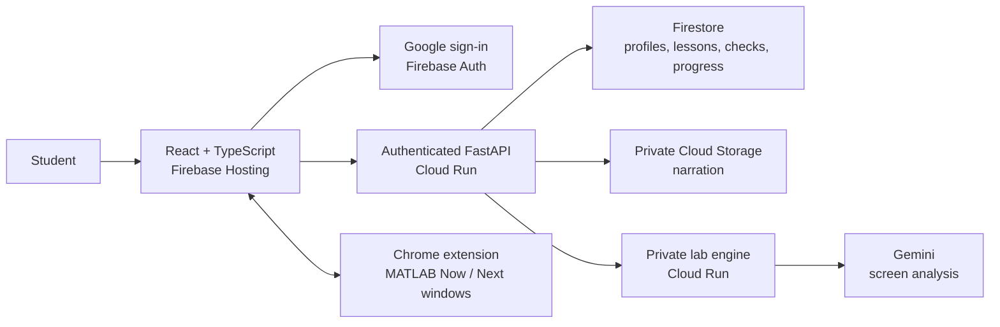

<p align="center"></p>

# Kiki · Understand in your language. Build with confidence.

Engineering is hard enough without having to translate every idea in your head first. **Kiki helps students learn engineering in a familiar language while keeping the English technical terms they need for class, exams and the lab.**

Our shipped pilot teaches **Analog Modulation through Odia and English**, then brings Kiki into **MATLAB / Simulink Online** for student-controlled DSB-SC lab guidance. Built for the **Google AI Builder Cup** with Gemini, Firebase and Google Cloud.

**[Open Kiki](https://kiki-512012.web.app)** · **[Watch the demo](https://youtu.be/bhakeLoJr0g)** · **[Download the Chrome extension](https://github.com/Kikiland-ai/.github/raw/refs/heads/main/downloads/kiki-windows-0.1.3.zip)** · **[Agent guide](https://github.com/Kikiland-ai/.github/blob/main/AGENTS.md)**

## Watch Kiki in action

[](https://youtu.be/bhakeLoJr0g)

Click the thumbnail to watch. GitHub displays a linked video preview rather than an embedded YouTube player.

## A five-minute judge's tour

1. **[Open Kiki](https://kiki-512012.web.app)** and sign in with Google. Choose your language, field, confidence and support preferences; add **Analog Communication** with your semester. The prepared learning path is **Odia/English + ECE**; other preferences can be saved, with availability explained.
2. **Learn one concept.** Open the Analog Modulation chapter and choose a lesson. Read its four steps: **Definition → Concept → Application → Recap**. Move the five-level language dial and open an English technical term for its Odia support.
3. **Hear and explore it.** Press **Listen**, change playback speed, and try a diagram's sliders and Reset. For Odia **and English** narration plus a phase-recovery scene, try **C-AM-08**. All ten concepts have Odia narration; English narration is currently available only in C-AM-08.
4. **Check your understanding.** Answer a five-question concept check, inspect feedback and return to the chapter map. Draft answers and lesson positions save; reading or moving a slider never awards a pass.
5. **Enter Lab mode.** Save DSB-SC preparation notes, inspect the twelve checkpoints and resume your preparation later. On desktop Chrome, install the extension to put **Now / Next** windows on your MATLAB tab; follow the [installation and lab guide](https://github.com/Kikiland-ai/.github/blob/main/docs/EXTENSION.md).

**Live lab availability:** the first hosted screen-analysis trial used its five-check allowance. Further hosted AI checks need the project team to authorize additional capacity. The extension is downloadable and the learning/preparation flows remain available; see the video and [recorded live trial](https://github.com/Kikiland-ai/kiki-backend/blob/main/docs/verification/hosted-trial-2026-10-18.md) for the verified lab demonstration. A MathWorks account with MATLAB/Simulink Online access is needed for the lab.

## What we've shipped

| Experience | What you can do |
| --- | --- |
| Your learning space | Google sign-in, resumable onboarding, editable language/field/support preferences, subject enrollment and a returning-student Home. |
| Bilingual lessons | Explore all **10 Analog Modulation concepts** through four teaching steps each, a student-controlled **five-level language dial**, technical-term chips and Odia/English glossary support. |
| Interactive teaching models | Explore signals, communication flow, AM, DSB-SC, spectrum, receiver, filtering, phase recovery, FM and PM with keyboard-operable controls and Reset. |
| Narration | **26 published recordings**: 22 Odia and 4 English. Play, pause, seek and adjust speed. Audio starts only when requested; language changes stop playback. |
| Checks and feedback | Five-question concept checks (**3/5 to pass**), a ten-question chapter test (**8/10**, after all ten concepts pass), saved drafts, server-side grading, feedback, retries and attempt history. |
| Progress that survives a return | Saved lesson step, language preference, owned assessment records and Home/chapter continuation through the authenticated API and Firestore. |
| Your class material | Add selectable-text **PDF/PPTX** notes, syllabus or lab manuals, up to **10 MB each / five documents**. Text is extracted and saved; Library shows filename, type, topic and date. |
| Lab preparation | DSB-SC aim, seven-concept theory-readiness view, **12 checkpoints**, prediction/model-reference/observation drafts and an owner-only continuation link. |
| Lab screen guidance | Explicit tab sharing, Gemini screen observation, streamed decisions, current/next action, student responses and confirmations, pause/resume/Stop and recovery that requires a new Share gesture. |
| Floating Kiki | A **Chrome Manifest V3 extension** puts movable, split/docked/minimized guidance windows on the selected MATLAB tab, with connection state and controls. Kiki windows are masked from submitted frames. |
| One responsive application | The Engineering Sketchbook interface adapts to desktop and phone layouts, with keyboard controls, reduced-motion handling and save/error recovery. Screen-share labs use desktop Chrome. |

[Full feature inventory and source evidence →](https://github.com/Kikiland-ai/.github/blob/main/docs/FEATURES.md)

## Try it locally

For a credential-free, explicitly labelled sample, install **Node.js 24.12+**:

```sh
git clone https://github.com/Kikiland-ai/kiki-web.git
cd kiki-web/apps/web
npm ci
npm run dev
```

Open **http://127.0.0.1:5173**, choose **Open sample student**, complete setup and add Analog Communication. This sample saves synthetic data in your browser. Use the hosted app for Google sign-in and cloud persistence.

For connected Python/Firebase setup and local lab services, see [Quick setup](https://github.com/Kikiland-ai/.github/blob/main/docs/SETUP.md). To use the extension without building anything, [download the ZIP](https://github.com/Kikiland-ai/.github/raw/refs/heads/main/downloads/kiki-windows-0.1.3.zip), extract it, open `chrome://extensions`, enable **Developer mode**, select **Load unpacked** and choose the extracted folder containing `manifest.json`.

## How the pieces fit



The browser uses Kiki's authenticated API; provider credentials stay server-side. Generated teaching assets reach the app through published content/media records. The student operates MATLAB and explicitly confirms their own work.

## The repositories

| Repository | What it contributes |
| --- | --- |
| [Design-Thinking](https://github.com/Kikiland-ai/Design-Thinking) | Product rationale, learning journeys, feature specifications, reusable data model, Breadboard design system and Kiki artwork. |
| [kiki-web](https://github.com/Kikiland-ai/kiki-web) | The shipped responsive React app and its authenticated Python/Firebase API: accounts, learning, checks, Library, media and lab integration. |
| [kiki-backend](https://github.com/Kikiland-ai/kiki-backend) | Lab engine, screen reading/tracking, floating-window extension, bilingual text/speech experiments and concept-canvas/content publishing tools. |

## The bigger idea, and today's boundary

Kiki's design separates **understanding, technical vocabulary, academic English and practical skill**. Today's checks assess concepts; confidence ratings, listening, diagrams and preparation notes do not imply mastery in the other dimensions.

The shipped teaching catalog is Odia/English ECE, even though the profile accepts other languages and fields. Scientific, native-Odia and pronunciation reviews remain pending. Some clips cover a whole concept; sentence-level audio alignment is not implemented. Teaching models are idealized and do not control Simulink. The hosted lab trial verified sharing, real analysis, coherent guidance and Stop, with **0/12 stages completed** in that bounded trial.

Handwritten-answer OCR with separate concept/English marking, automated repair maps, viva practice, teacher dashboards, full adaptive curation and broad course/language coverage remain design directions. They are not presented as shipped features.

## For humans. For agents.

**Humans:** start with the app, demo and five-minute tour above. **Agents:** start with [AGENTS.md](https://github.com/Kikiland-ai/.github/blob/main/AGENTS.md), then [evaluation.json](https://github.com/Kikiland-ai/.github/blob/main/docs/evaluation.json) for structured capabilities, source revisions, setup commands and explicit claim limits. Same project, two ways in; neither requires guessing what is real.
